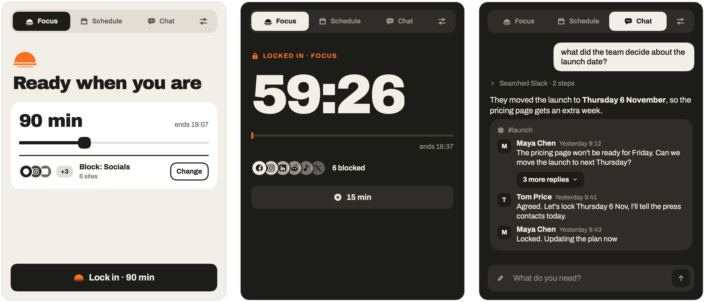

<div align="center">

<picture>
  <source media="(prefers-color-scheme: dark)" srcset="BrowserExtension/ortus-logo-on-ink.svg" />
  
</picture>

### No end button. The focus app that doesn't trust you.

A free, open source Mac app that locks you out of the apps and websites you choose until the session ends,
with an agent that gets you what you need from them. Need a message from Slack? Ask. Nothing opens.

[](https://ortusmode.com)
[](https://github.com/scandolo/Ortus/releases/latest)
[](https://ortusmode.com)
[](Package.swift)
[](LICENSE)

[Website](https://ortusmode.com) · [Install](#install) · [How it works](#how-it-works) · [Your agent](#your-agent) · [Development](#development)

<br />



</div>

---

## What is Ortus?

Ortus lives in your Mac menu bar and does two things.

**It locks you in.** Pick what to block and for how long, then press **Lock in**, or let a schedule start the session for you. Until it ends, Ortus closes the Mac apps in your mode. With the browser extension, it blocks the websites too.

**Your agent keeps you in the loop.** During a session, ask Ortus for the message, thread or file you need. Chat runs the Claude Code already on your Mac, with your sign-in and whatever you connected to it, like Slack, Gmail or your calendar, and answers right inside Ortus. You get what you came for without the feed around it. It drafts replies for you and asks before it sends or changes anything.

### Modes and the lock

**Socials**, the default, blocks LinkedIn, X (x.com and twitter.com), Instagram, Facebook, Reddit and TikTok. **Messages** blocks Gmail, Slack and WhatsApp. **Everything** blocks both. Choose **Change → New custom mode** to add websites and Mac apps of your own. Schedules use the same modes.

Websites include their subdomains. Gmail is mail.google.com and gmail.com only, so the rest of Google stays open. Slack is the Mac app and slack.com. WhatsApp is the Mac app and web.whatsapp.com. Reopen a blocked app and Ortus closes it again. Ortus, Finder and System Settings stay available.

There is no end button. Quitting Ortus is blocked while a session runs. A session you start gives you a short grace period to press **Never mind**; a scheduled session locks right away. After that, the only way out is **End focus early** in Settings, once a week. The first time you lock in, Ortus shows what it will block and when it ends.

The panel is bone while you're free and ink while you're locked, so you can tell at a glance. When the timer ends, the websites load again. Apps Ortus closed stay closed until you open them. The weekly emergency end reopens them.

If Slack is connected, Ortus also sets your Slack status and Do Not Disturb when a session closes the Slack app, and clears them when it ends.

> Willpower runs out. A locked session doesn't.

## Website blocking

Mac apps close on their own. Websites need the companion extension.

Install [Ortus · Website blocking](https://chromewebstore.google.com/detail/ortus-·-website-blocking/lheanmgemlbnpeonkdbbinmankaineao) from the Chrome Web Store. Chrome, Arc, Edge and Brave can install it. Safari and Firefox are not supported. The extension requires Chromium 120 or later.

After you add it, open its Details and turn on **Allow in Incognito**, so private windows are covered. Repeat that for each browser profile.

During a website session, a browser that has connected before must keep the extension on and allowed in incognito. Otherwise Ortus opens a warning tab, counts down 60 seconds in the menu bar, and quits the browser. Reopen it and the countdown starts again.

**Settings → Website blocking → Set up** opens this listing in the browser you choose. Then open the extension’s Details and turn on **Allow in Incognito**.

**Load unpacked.** Use this for a build from source, or for work on `BrowserExtension/`. In **Set up**, open **Install from a folder**. Turn on Developer mode, then choose **Load unpacked**. Select the folder beside the app, `Ortus Browser`, or `Ortus Preview Browser` for a preview. The published extension calls the Ortus host, so it connects to Ortus. A preview connects only to the extension in its own folder. Allow it in incognito. Reload the extension after a new build.

## How it works

1. You choose a mode and a length, or a schedule reaches its window. A session you start yourself runs from 15 minutes to 4 hours. The first time, Ortus shows what it will block and when it ends before it locks in. You can add 15 minutes from the panel while it runs.
2. Ortus terminates the Mac apps in the mode and watches for launches. If one starts, Ortus closes it, and force-quits it if it keeps running.
3. The extension replaces a blocked site with a page inside the extension. It also blocks that site's other requests. `api.slack.com` is excluded. Rules clear within 20 seconds if Ortus stops updating them. No browsing data is sent to Ortus.
4. `applicationShouldTerminate` returns `.terminateCancel` while a session is running, so Cmd+Q, Dock quit and a programmatic quit all fail. When the session ends, monitoring stops and the website rules expire. Closed apps stay closed. The weekly emergency end reopens them.

## Install

### Download (recommended)

Download `Ortus.dmg` from [ortusmode.com/download](https://ortusmode.com/download), open
it and drag Ortus into Applications. Releases are signed and notarized by Apple. Requires
macOS 14 or later, on Apple silicon or Intel. Websites stay open until you add the
[browser extension](#website-blocking).

### One-line install

```bash
curl -fsSL https://ortusmode.com/install.sh | bash
```

This downloads the latest release into `/Applications` and launches it.

### Build from source

```bash
git clone https://github.com/scandolo/Ortus.git
cd Ortus
./build.sh release   # builds Ortus.app; plain ./build.sh makes a preview instead
open Ortus.app
```

Requires macOS 14+ and the Swift 6 toolchain (Xcode).

### Your agent

Chat uses your locally installed Claude Code and its existing sign-in and
connectors. Ortus blocks apps and websites without it; Chat needs it. Ortus detects it automatically. Open **Settings → Chat → Configure**
to change its location or check again; leave the location empty to use automatic
detection.

## Privacy

There are no Ortus accounts. If you connect Slack, the token is stored in the
macOS login keychain and is not synced to iCloud.
Ortus sends that token only to Slack. Chat uses Claude Code's existing authentication.
If you opt in (on the welcome page or in Settings), Ortus sends anonymous usage
events via PostHog. The browser extension talks only to the Ortus app on your Mac.
[Privacy policy](https://ortusmode.com/privacy).

## Development

Ortus is a SwiftUI macOS menu-bar app built with Swift Package Manager. It runs as
a `MenuBarExtra` with `.window` style (a popover panel) and no dock icon
(`LSUIElement = true`).

### Preview

A preview is a separate app (`Ortus Preview`, `com.ortusmode.preview`), with its own
settings, session lock and browser companion.

```bash
./build.sh preview
python3 scripts/install-preview.py
open "/Applications/Ortus Preview.app"
```

### Checks

```bash
swift run OrtusCoreChecks                       # core model
node --test BrowserExtension/tests/*.test.js    # extension logic
bash scripts/test-app-blocking.sh               # app blocking with a fixture app
bash scripts/test-modal-scrolling.sh            # compact and scrollable panel modals
bash scripts/test-brand-glyphs.sh               # website brands and mode marks
python3 scripts/test-browser.py                 # end to end in headless Chromium (needs Playwright)
scripts/snapshot.sh <dir> [--session]           # renders every panel state to PNGs
```

`scripts/package-extension.sh` writes `Ortus-extension.zip` for the Chrome Web Store.
The manifest `key` stays in the repo so a Load unpacked build keeps a stable id.
The store package leaves that key out.

### How the pieces talk

`Sources/OrtusCore` holds the shared model (targets, modes, schedules, sessions, browser policy). The app writes a short-lived policy on disk. `OrtusBrowserBridge`, a Native Messaging host, passes it to the extension. The extension applies it only while the heartbeat is fresh. Nothing about the pages you open is sent to Ortus.

### Project structure

```
Ortus/
├── Package.swift              # SPM config, macOS 14+: app, OrtusCore, bridge, core checks
├── AGENTS.md                  # Release process and checks for coding agents (CLAUDE.md links here)
├── build.sh                   # Builds Ortus.app (release) or Ortus Preview.app (debug, preview)
├── landing/                   # The website (ortusmode.com), deployed by Vercel from main
├── BrowserExtension/          # Chromium companion: blocking rules, blocked page, popup, brand fonts and logo
├── Sources/
│   ├── OrtusCore/             # Shared model: targets, modes, schedules, sessions, browser policy, chat stream and answer blocks
│   └── OrtusBrowserBridge/    # Native Messaging host between the app and the extension
├── Tests/OrtusCoreTests/      # Core checks (run with Command Line Tools only)
├── scripts/                   # Preview installer, panel snapshots, release notarization, extension packaging, integration tests
└── Ortus/
    ├── OrtusApp.swift         # @main entry, MenuBarExtra scene and menu bar icon, quit-blocking AppDelegate
    ├── Fonts/                 # Archivo and Archivo Black (OFL), copied into the app by build.sh
    ├── Models/                # ChatMessage, emoji catalog, Slack API types
    ├── Services/
    │   ├── FocusManager.swift # Sessions, modes, schedules, emergency end
    │   ├── ApplicationBlocker.swift    # Closes and watches blocked Mac apps
    │   ├── WebsiteBlockingService.swift# Publishes the browser policy, browser setup
    │   ├── ClaudeCodeService.swift     # Chat via the local Claude Code CLI
    │   ├── SlackService.swift # Slack Web API client
    │   ├── SlackOAuthService.swift # OAuth flow via a loopback HTTP server
    │   ├── KeychainService.swift   # Slack token in the macOS login keychain
    │   ├── UpdateService.swift     # Release updates
    │   └── Analytics.swift    # Thin PostHog wrapper (anonymous usage events)
    ├── Views/
    │   ├── OrtusTheme.swift   # First Light tokens, fonts, button and toggle styles, and the visual rules
    │   ├── OrtusIcons.swift   # Brand icons, the sun mark and the menu bar tile, drawn from SVG paths
    │   ├── OrtusComponents.swift   # Rows, groups, modals, problem notes, pressable style, flow layout
    │   ├── BrandGlyph.swift   # Monochrome site marks and the blocked-app stack
    │   ├── ContentView.swift  # Tab container (Focus, Schedule, Chat, Settings) and modals
    │   ├── FocusView.swift    # Length and mode card, grace window, running session, first-lock sheet
    │   ├── OrtusDurationSlider.swift   # The session length slider
    │   ├── BlockingTargetsEditor.swift # Mode picker, mode builder, browser setup
    │   ├── ScheduleView.swift # Recurring schedules with inline editing and the time field
    │   ├── ChatView.swift     # Chat with Claude Code: messages, activity line, input bar
    │   ├── ChatAnswerView.swift    # Answers as paragraphs, lists and cards for quoted messages
    │   └── SettingsView.swift # Connections, Slack status, general, Slack setup
    └── Debug/
        ├── SnapshotHarness.swift   # Debug-only offscreen renders of every panel state
        └── ChatFixtures.swift # Made-up chat turns for the snapshots, replayed through the stream parser
```

### Key design decisions

- **No End Focus button.** An easy escape defeats the purpose. Emergency end lives
  in Settings and is gated to once per calendar week (`weekOfYear`). It shows up
  only while a session is locked. Developer mode (tap the version label 7 times)
  adds a dev-only end button.
- **Closed apps stay closed.** A normal ending stops blocking. The apps Ortus quit
  stay quit. Emergency end relaunches them.
- **Inline editing in ScheduleView.** `.sheet()` spawns a new `NSWindow`, which makes
  the `MenuBarExtra` panel lose key-window status and dismiss. Schedules are edited
  in place with state variables instead.
- **Quit blocking via AppDelegate.** `applicationShouldTerminate` returns
  `.terminateCancel` while focus is active, blocking Cmd+Q, Dock quit and
  programmatic termination. That includes the grace window.
- **Bone when free, ink when locked.** The panel takes its colours from the
  session's lock state, never from macOS dark mode (`ortusLockAppearance` in
  `OrtusTheme.swift`). Persimmon is for the sun, the locked label and problems.
  The visual rules are at the top of `OrtusTheme.swift`.
- **Website rules fail open.** If Ortus stops publishing a heartbeat, the extension
  drops its block rules within 20 seconds.

### Dependencies

[PostHog](https://github.com/PostHog/posthog-ios) for anonymous usage analytics.
Everything else is Apple frameworks only (AppKit, CoreText, Security, Network,
UserNotifications, ServiceManagement).

## License

[MIT](LICENSE). Free and open source. The Archivo fonts are under the SIL Open Font License (`Ortus/Fonts`).

<div align="center"><sub>Ortus is Latin for rising.</sub></div>
