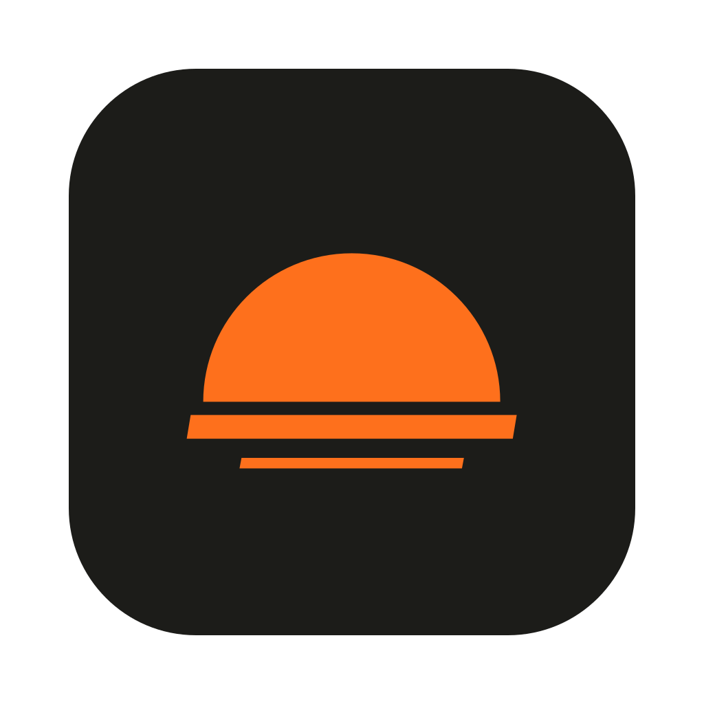
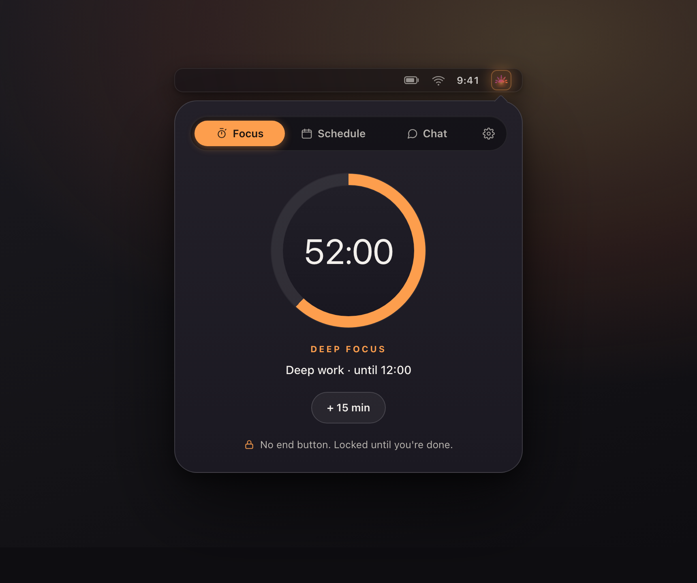

<div align="center">



# Ortus

**The most hardcore focus app for makers.**
A free, open source Mac menu-bar app. It closes the apps you choose and blocks the sites you choose until the session is over.

[](https://ortusmode.com)
[](https://github.com/scandolo/Ortus/releases/latest)
[](https://ortusmode.com)
[](Package.swift)
[](LICENSE)

[Website](https://ortusmode.com) · [Install](#install) · [How it works](#how-it-works) · [Development](#development)

<br />



</div>

---

## What is Ortus?

Ortus lives in your Mac menu bar. Start a session yourself, or let a schedule start one. Until that session ends, Ortus closes the Mac apps in your mode. With the browser extension, it blocks the websites too.

**Socials**, the default, blocks LinkedIn, X (x.com and twitter.com), Instagram, Facebook, Reddit, and TikTok. **Messages** blocks Gmail, Slack, and WhatsApp. **Everything** blocks both. Choose **Change → New custom mode** to add websites and Mac apps of your own. Schedules use the same modes.

Websites include their subdomains. Gmail is mail.google.com and gmail.com only, so the rest of Google stays open. Slack is the Mac app and slack.com. WhatsApp is the Mac app and web.whatsapp.com. Reopen a blocked app and Ortus closes it again. Ortus, Finder, and System Settings stay available.

There is no End Focus button to talk yourself into. Quitting Ortus is blocked while a session is running. A session you start yourself gives you 30 seconds to press **Never mind**. A scheduled session has no cancel window. The remaining way out is **End focus early** in Settings, once a week. Before your first session, Ortus shows what it will block, when it ends, and that one way out.

When the timer ends, the websites load again. Apps Ortus closed stay closed until you open them. The weekly emergency end reopens those apps.

Slack status and chat are optional. When a session closes the Slack app, and Slack is connected, Ortus sets your status and Do Not Disturb. It clears them when the session ends. Turn either off in Settings. Chat runs the Claude Code already on your Mac. It uses your sign-in and the tools you connected there, so you can check Slack without opening it.

> Willpower runs out. A locked session doesn't.

## Website blocking

Mac apps close on their own. Websites need the companion extension.

Install [Ortus · Website blocking](https://chromewebstore.google.com/detail/ortus-·-website-blocking/lheanmgemlbnpeonkdbbinmankaineao) from the Chrome Web Store. Chrome, Arc, Edge, and Brave can install it. Safari and Firefox are not supported. The extension requires Chromium 120 or later.

After you add it, open its Details and turn on **Allow in Incognito**, so private windows are covered. Repeat that for each browser profile.

During a website session, a browser that has connected before must keep the extension on and allowed in incognito. Otherwise Ortus opens a warning tab, counts down 60 seconds in the menu bar, and quits the browser. Reopen it and the countdown starts again.

**Load unpacked.** The store listing above is the install path for the signed app. **Settings → Website blocking → Set up** still walks through Load unpacked. Use that for a build from source, or for work on `BrowserExtension/`. Turn on Developer mode in the browser, then choose **Load unpacked**. Select the folder beside the app, `Ortus Browser`, or `Ortus Preview Browser` for a preview. Allow it in incognito. Reload the extension after a new build.

## How it works

1. You choose a mode and a length, or a schedule reaches its window. A session you start yourself runs from 15 minutes to 4 hours. The first time you start one, Ortus asks you to confirm with **Understood, start**. You can add 15 minutes from the panel while it runs.
2. Ortus terminates the Mac apps in the mode and watches for launches. If one starts, Ortus closes it, and force-quits it if it keeps running.
3. The extension replaces a blocked site with a page inside the extension. It also blocks that site's other requests. `api.slack.com` is excluded. Rules clear within 20 seconds if Ortus stops updating them. No browsing data is sent to Ortus.
4. `applicationShouldTerminate` returns `.terminateCancel` while a session is running, so Cmd+Q, Dock quit, and a programmatic quit all fail. When the session ends, monitoring stops and the website rules expire. Closed apps stay closed. The weekly emergency end reopens them.

## Install

### Download (recommended)

Download `Ortus.dmg` from [ortusmode.com/download](https://ortusmode.com/download), open
it and drag Ortus into Applications. Releases are signed and notarized by Apple. Requires
macOS 14 or later, on Apple silicon or Intel. Websites stay open until you add the
[browser extension](#website-blocking).

### One-line install

```bash
curl -fsSL https://ortusmode.com/install.sh | bash
```

This downloads the latest release into `/Applications` and launches it.

### Build from source

```bash
git clone https://github.com/scandolo/Ortus.git
cd Ortus
./build.sh release   # builds Ortus.app; plain ./build.sh makes a preview instead
open Ortus.app
```

Requires macOS 14+ and the Swift 6 toolchain (Xcode).

### AI chat (optional)

Chat uses your locally installed Claude Code and its existing sign-in and
connectors. Ortus detects it automatically. Open **Settings → Chat → Configure…**
to change its location or check again; leave the location empty to use automatic
detection.

## Privacy

There are no Ortus accounts. If you connect Slack, the token is stored in
`~/Library/Application Support/Ortus/credentials.json`, readable only by your user.
Ortus sends that token only to Slack. Chat uses Claude Code's existing authentication.
If you opt in (on the welcome page or in Settings), Ortus sends anonymous usage
events via PostHog. The browser extension talks only to the Ortus app on your Mac.
[Privacy policy](https://ortusmode.com/privacy).

## Development

Ortus is a SwiftUI macOS menu-bar app built with Swift Package Manager. It runs as
a `MenuBarExtra` with `.window` style (a popover panel) and no dock icon
(`LSUIElement = true`).

### Preview

A preview is a separate app (`Ortus Preview`, `com.ortusmode.preview`), with its own
settings, session lock, and browser companion.

```bash
./build.sh preview
python3 scripts/install-preview.py
open "/Applications/Ortus Preview.app"
```

### Checks

```bash
swift run OrtusCoreChecks                       # core model
node --test BrowserExtension/tests/*.test.js    # extension logic
bash scripts/test-app-blocking.sh               # app blocking with a fixture app
bash scripts/test-modal-scrolling.sh            # compact and scrollable panel modals
bash scripts/test-brand-glyphs.sh               # website brands and mode marks
python3 scripts/test-browser.py                 # end to end in headless Chromium (needs Playwright)
```

`scripts/package-extension.sh` writes `Ortus-extension.zip` for the Chrome Web Store.
The manifest `key` stays in the repo so a Load unpacked build keeps a stable id.
The store package leaves that key out.

### How the pieces talk

`Sources/OrtusCore` holds the shared model (targets, modes, schedules, sessions, browser policy). The app writes a short-lived policy on disk. `OrtusBrowserBridge`, a Native Messaging host, passes it to the extension. The extension applies it only while the heartbeat is fresh. Nothing about the pages you open is sent to Ortus.

### Project structure

```
Ortus/
├── Package.swift              # SPM config, macOS 14+: app, OrtusCore, bridge, core checks
├── AGENTS.md                  # Release process and checks for coding agents (CLAUDE.md links here)
├── build.sh                   # Builds Ortus.app (release) or Ortus Preview.app (debug, preview)
├── landing/                   # The website (ortusmode.com), deployed by Vercel from main
├── BrowserExtension/          # Chromium companion: blocking rules, blocked page, popup
├── Sources/
│   ├── OrtusCore/             # Shared model: targets, modes, schedules, sessions, browser policy, chat stream and answer blocks
│   └── OrtusBrowserBridge/    # Native Messaging host between the app and the extension
├── Tests/OrtusCoreTests/      # Core checks (run with Command Line Tools only)
├── scripts/                   # Preview installer, panel snapshots, release notarization, extension packaging, integration tests
└── Ortus/
    ├── OrtusApp.swift         # @main entry, MenuBarExtra scene, quit-blocking AppDelegate
    ├── Models/                # ChatMessage, emoji catalog, Slack API types
    ├── Services/
    │   ├── FocusManager.swift # Sessions, modes, schedules, emergency end
    │   ├── ApplicationBlocker.swift    # Closes and watches blocked Mac apps
    │   ├── WebsiteBlockingService.swift# Publishes the browser policy, browser setup
    │   ├── ClaudeCodeService.swift     # Chat via the local Claude Code CLI
    │   ├── SlackService.swift # Slack Web API client
    │   ├── SlackOAuthService.swift # OAuth flow via a loopback HTTP server
    │   ├── KeychainService.swift   # Local credential file for the Slack token
    │   ├── UpdateService.swift     # Release updates
    │   └── Analytics.swift    # Thin PostHog wrapper (anonymous usage events)
    ├── Views/
    │   ├── OrtusTheme.swift   # Design tokens and button styles (shared with extension/landing)
    │   ├── OrtusComponents.swift   # Rows, groups, modals, pressable style, flow layout
    │   ├── BrandGlyph.swift   # Monochrome site marks and the floating mode cluster
    │   ├── ContentView.swift  # Tab container (Focus, Schedule, Chat, Settings) and modals
    │   ├── FocusView.swift    # Timer, duration and mode card, grace period
    │   ├── OrtusDurationSlider.swift   # The sunrise duration slider
    │   ├── BlockingTargetsEditor.swift # Mode picker, mode builder, browser setup
    │   ├── ScheduleView.swift # Recurring schedules with inline editing
    │   ├── ChatView.swift     # Chat with Claude Code: messages, activity line, input bar
    │   ├── ChatAnswerView.swift    # Answers as paragraphs, lists and cards for quoted messages
    │   └── SettingsView.swift # Connections, Slack status, general, Slack setup
    └── Debug/
        ├── SnapshotHarness.swift   # Debug-only offscreen renders of every panel state
        └── ChatFixtures.swift # Made-up chat turns for the snapshots, replayed through the stream parser
```

### Key design decisions

- **No End Focus button.** An easy escape defeats the purpose. Emergency end lives
  in Settings and is gated to once per calendar week (`weekOfYear`). It shows up
  only while a session is locked. Developer mode (tap the version label 7 times)
  adds a dev-only end button.
- **Closed apps stay closed.** A normal ending stops blocking. The apps Ortus quit
  stay quit. Emergency end relaunches them.
- **Inline editing in ScheduleView.** `.sheet()` spawns a new `NSWindow`, which makes
  the `MenuBarExtra` panel lose key-window status and dismiss. Schedules are edited
  in place with state variables instead.
- **Quit blocking via AppDelegate.** `applicationShouldTerminate` returns
  `.terminateCancel` while focus is active, blocking Cmd+Q, Dock quit, and
  programmatic termination. That includes the 30-second cancel window.
- **Lifted cards.** Cards use `cardSurface`, lighter than the canvas in light and
  dark mode, with continuous corner radii. The amber accent is the timer ring and
  the menu-bar icon.
- **Website rules fail open.** If Ortus stops publishing a heartbeat, the extension
  drops its block rules within 20 seconds.

### Dependencies

[PostHog](https://github.com/PostHog/posthog-ios) for anonymous usage analytics.
Everything else is Apple frameworks only (AppKit, Security, Network,
UserNotifications, ServiceManagement).

## License

[MIT](LICENSE). Free and open source.

<div align="center"><sub>Carpe lucem.</sub></div>
