# One-click agent setup, and Codex as a second engine

Research, user flows, engineering spec and mock-ups. Proposal only: nothing here is built.
Written 25 Nov 2026, after the maintainer's fresh-account test on 24 Nov.

## In one minute

- **Install can be one click, with no Terminal and no password.** Claude Code's official installer is a 261-line script that downloads a signed binary into the home folder and runs `claude install`. Ortus can do the same steps itself, show real progress, and check one thing the script skips: that the binary is signed by Anthropic.
- **Sign-in can happen without Terminal.** `claude auth login` opens the browser and waits for a `localhost` callback, with no terminal attached (tested up to the browser step). `claude auth status --json` answers "signed in or not" with exit code 0 or 1. Ortus runs the first, watches the second, and moves on by itself.
- **Codex fits the same approach.** `codex exec --json` gives the same shape of events (tool calls, then an answer), `codex login` signs in through the browser without a terminal, and `codex login status` answers with exit 0 or 1. The differences: Codex names the session itself, its install script is long enough that Ortus should run it rather than copy it, and MCP tools only run without prompts when approvals are bypassed (as Ortus already does for Claude Code).
- **Don't build on the copies inside the Claude and ChatGPT apps.** Both apps keep a signed CLI on disk, but in undocumented, versioned folders that change with app updates, and the ChatGPT one is an alpha build. Detect them, then install a normal copy.
- **Terms:** Anthropic explicitly allows a user signing in to the unmodified Claude Code binary through Anthropic's own flow. It also says products that run Claude Code agree to its Commercial Terms. That's the one item to settle before shipping (decision 1).
- **Effort:** about 7 to 10 working days for all of it, in three shippable steps. Sign-in first: it's the biggest pain and the smallest change.

Mock-ups: see [Mock-ups](#mock-ups) below.

## Decisions for the maintainer

Each has a recommendation. All are reversible later.

1. **Anthropic's Commercial Terms.** The Claude Code legal page says "preinstalling or running Claude Code in your products or services … requires agreeing to our Commercial Terms of Service", with conditions Ortus already meets (unmodified binary, each user signs in with their own account, nothing resold). Options: (a) accept the Commercial Terms by opening a free Claude Console organisation for Ortus, (b) also email Anthropic to confirm a free, local, open-source app is fine, (c) do nothing. **Recommend (a) now and (b) before any launch push.** Not legal advice.
2. **How Ortus installs.** For Claude Code: (a) run `curl -fsSL https://claude.ai/install.sh | bash` silently, or (b) do the script's five steps in Swift (same URLs, same checksum, same final `claude install`), adding a real progress bar and an Anthropic signature check before anything runs. **Recommend (b).** For Codex, run OpenAI's script with `CODEX_NON_INTERACTIVE=1`: it's 1,481 lines and `codex update` depends on what it writes, so copying it would drift. Ortus checks the OpenAI signature on the result before first use. Both keep "Copy the Terminal command" as the fallback, and the same files end up in the same places as a manual install.
3. **Ask by plan, not by product.** The first screen asks "Which plan do you have? Claude / ChatGPT" and installs the matching CLI. The alternative is Claude Code by default with a "Use ChatGPT instead" link. **Recommend asking**: one tap, and it makes Codex visible to people who'd otherwise leave.
4. **The copies inside the desktop apps.** (a) Never run them; use them only to tailor the message ("Claude is here, Claude Code isn't"). (b) Run them as a fallback, re-resolving the newest folder and checking the signature each time. **Recommend (a).** Install is now one click, and (b) builds on a path Anthropic has changed twice and doesn't document.
5. **"Find my Claude Code".** The other branch tonight has two equal buttons, Install and Find. With detection covering standard installs, Homebrew, npm and the login shell, Find is rare. **Recommend a text link under Install**, as in the mock-ups.
6. **Codex permissions.** In `codex exec`, MCP tools (Slack, Gmail…) need approval unless they declare themselves read-only, and exec rejects approval requests. (a) `--dangerously-bypass-approvals-and-sandbox`: every tool runs, like `--permission-mode bypassPermissions` for Claude Code today; the system prompt's draft-before-sending rule is the guard in both. (b) A read-only sandbox plus per-server `approval_mode = "approve"` overrides: shell commands can't write, but Ortus must list the user's servers first and keep the overrides in step. **Recommend (a) for parity**, (b) as later hardening for both engines.
7. **Codex settings home.** Use the user's own `~/.codex` (their sign-in, MCP servers and connected apps) or a separate `CODEX_HOME` for Ortus (lighter runs, but its own sign-in and no apps). **Recommend the user's own**: their sign-in and connectors are the point. Trim per run with `-c` overrides if runs are too heavy.
8. **Order.** Ship sign-in (step 1), then install (step 2), then Codex behind Experimental (step 3). **Recommend this order.**

## What exists today

Read from the code on `main` (aa17579).

- `Ortus/Services/ClaudeCodeService.swift` finds `claude` in this order: the location override; `~/.local/bin/claude`, `/opt/homebrew/bin/claude`, `/usr/local/bin/claude`, `~/.claude/local/claude`, `/run/current-system/sw/bin/claude`; then `$SHELL -ilc "command -v claude"` with a 5 s watchdog.
- Each message runs `claude -p <prompt> --output-format stream-json --verbose --model claude-sonnet-5-5 --effort low --append-system-prompt <…> --permission-mode bypassPermissions` with `--session-id <uuid>` on the first turn and `--resume <uuid>` after. The environment is Ortus's own.
- `Sources/OrtusCore/ChatTurn.swift` reads Claude Code's stream-json directly (`system/init`, `assistant` blocks, `user` tool results, `result`). There is no engine abstraction.
- `ChatSetupModal` (in `SettingsView.swift`) shows found / not found, a location field, and an "Install Claude Code" link to docs.claude.com.
- Signed out today: the turn fails with "Claude Code could not finish this request. Check assistant setup or retry." The details say `Not logged in · Please run /login`, and `/login` replies "/login isn't available in this environment." So the user has to find Terminal.

## Research

### 1. Install, location and updates

**Claude Code** ([setup docs](https://code.claude.com/docs/en/setup))

| Method | Command | Binary | Updates |
|---|---|---|---|
| Native installer (recommended by Anthropic) | `curl -fsSL https://claude.ai/install.sh \| bash` | `~/.local/bin/claude` → `~/.local/share/claude/versions/<v>` | Checks at start and in the background, applies on next start; `claude update`. Keeps the two newest versions. |
| Homebrew | `brew install --cask claude-code` | `/opt/homebrew/bin/claude` | Through `brew upgrade` only. |
| npm | `npm install -g @anthropic-ai/claude-code` (needs Node 22+) | npm's global bin | Same native binary via an optional dependency. |
| Reinstall | `claude install [stable\|latest\|<v>]` | as native | — |

What `install.sh` does (read, not run; 261 lines):

1. Refuses to run under sudo: Claude Code "installs into your home directory and does not need root access".
2. Fetches the version from `https://downloads.claude.ai/claude-code-releases/latest` (2.1.331 today; `stable` is 2.1.325).
3. Fetches `<v>/manifest.json` and reads the platform's SHA-256 and size.
4. Downloads `<v>/darwin-arm64/claude` (or `darwin-x64`) into `~/.claude/downloads/`. If `zstd` is installed it downloads the 131 MB compressed file instead. Stock macOS has no `zstd`, so a fresh Mac downloads the full binary: **381 MB on Apple silicon, 397 MB on Intel.**
5. Checks the SHA-256. A mismatch stops the install.
6. Runs the downloaded binary as `claude install` from the download folder, then deletes the download.

It doesn't edit shell profiles. If `~/.local/bin` isn't on PATH it prints how to fix it ([troubleshooting](https://code.claude.com/docs/en/troubleshoot-install)). That doesn't matter to Ortus, which uses full paths.

What the script trusts: TLS to `downloads.claude.ai` and the manifest's checksum. It doesn't check the macOS code signature or the GPG signature (`manifest.json.sig`, available since 2.1.89). The binaries are signed `Developer ID Application: Anthropic PBC (Q6L2SF6YDW)` with the hardened runtime (checked on this Mac with `codesign`); the Claude app's copy also carries a stapled notarization ticket and passes `spctl`.

**Codex**

Docs: [Codex CLI](https://learn.chatgpt.com/docs/codex/cli) (OpenAI moved the docs to learn.chatgpt.com; developers.openai.com/codex still serves them).

| Method | Command | Binary | Updates |
|---|---|---|---|
| Official script | `curl -fsSL https://chatgpt.com/codex/install.sh \| sh` (redirects to `releases.openai.com/codex/install.sh`) | `~/.local/bin/codex` → `~/.codex/packages/standalone/current/…` | `codex update` re-runs the script; the script also writes an auto-update marker for scheduled updates |
| Homebrew | `brew install --cask codex` (no formula) | `/opt/homebrew/bin/codex` (on this Mac: 0.171.0) | `brew upgrade --cask codex`, or `codex update` |
| npm | `npm install -g @openai/codex` | npm's global bin; a Node launcher (`bin/codex.js`) in front of a native binary | `codex update` runs npm. Needs `node` on PATH, which a GUI app doesn't have. |
| GitHub releases | `codex-aarch64-apple-darwin.tar.gz` and others under `rust-v<version>` | wherever you put it | none |

What the official script does (read, not run; 1,481 lines): resolves the latest version from `releases.openai.com/codex` (falling back to GitHub Releases), downloads the package and a `codex-package_SHA256SUMS` file, checks the SHA-256, unpacks into `~/.codex/packages/standalone/releases/<version>`, points `current` at it, symlinks `~/.local/bin/codex`, **adds a PATH line to `~/.zprofile`** (zsh) or `~/.bash_profile` (bash), checks the installed command reports the expected version, and prunes old releases. It takes a lock, detects conflicting installs, and asks y/N questions on `/dev/tty` unless `CODEX_NON_INTERACTIVE=1`.

Signing: the Homebrew binary on this Mac is signed `Developer ID Application: OpenAI OpCo, LLC (2DC432GLL2)`; OpenAI's release workflow signs and notarizes macOS binaries. The plain-binary notarization wasn't checked (`spctl` only assesses apps).

### 2. Sign-in

**Claude Code** ([authentication](https://code.claude.com/docs/en/authentication), [CLI reference](https://code.claude.com/docs/en/cli-reference))

- Ways in: a Claude subscription (Pro, Max, Team, Enterprise) through OAuth; a Claude Console account (`claude auth login --console`); `ANTHROPIC_API_KEY`; `apiKeyHelper`; `claude setup-token` (a one-year token that only makes model requests and doesn't load claude.ai connectors); Bedrock, Vertex, Foundry.
- Stored in the macOS Keychain, keyed to the config folder.
- **Check without Terminal:** `claude auth status --json`. Tested on this Mac: signed in, exit 0 and `{"loggedIn": true, "authMethod": "claude.ai", "subscriptionType": "max", "email": …}`; signed out (a throwaway config folder), exit 1 and `{"loggedIn": false, "authMethod": "none"}`. The stream-json `apiKeySource` field can't tell: it says `none` for a subscription sign-in too.
- **Sign in without Terminal:** `claude auth login [--console] [--sso] [--email]`. Tested with stdin closed, no terminal and a stand-in `open` command, in a throwaway config folder: it printed "Opening browser to sign in…", called `open` with a claude.com authorize URL whose redirect is `http://localhost:<random port>/callback`, and waited. It also printed a manual link and "Paste code here if prompted >": when the browser can't reach localhost, the page shows a code and the CLI reads it from stdin. Not tested: approving in the browser and seeing the process exit (that would have signed the maintainer's Mac in to a throwaway config).
- **Signed out during a turn:** `-p` prints `Not logged in · Please run /login` as an error result (`is_error: true`) and exits 1. Tested.

**Codex**

Source: `codex-rs/cli/src/login.rs`, `codex-rs/login/src/server.rs`, [auth docs](https://learn.chatgpt.com/docs/auth), and `codex login --help` on 0.171.0.

- Ways in: ChatGPT sign-in (the CLI is included on Plus, Pro, Business, Enterprise and Edu; Free and Go list only the desktop app, [pricing](https://learn.chatgpt.com/docs/pricing)); an OpenAI API key (`codex login --with-api-key`, key on stdin); `CODEX_API_KEY` for `exec`.
- Stored in `~/.codex/auth.json` or the OS credential store (`cli_auth_credentials_store = file | keyring | auto`).
- **Check without Terminal:** `codex login status`. Exit 0 with "Logged in using ChatGPT" or "API key configured" (checked on this Mac: "Logged in using ChatGPT", exit 0); exit 1 with "Not logged in". It writes to stderr, so read both streams.
- **Sign in without Terminal:** `codex login` starts a local server on `127.0.0.1:1455` (1457 if busy), opens the browser to `auth.openai.com` itself, and exits 0 ("Successfully logged in") or 1. It doesn't read stdin or need a terminal. **It signs out existing credentials before starting**, so only offer it when signed out.
- Fallback: `codex login --device-auth` prints a link and a one-time code (beta; the user has to enable device-code sign-in in ChatGPT security settings first).

### 3. Non-interactive mode and events

**Claude Code** is what Ortus runs today: `-p … --output-format stream-json --verbose`. One JSON object per line: `system/init` (session, tools, MCP servers and their status), `assistant` messages with `text`, `thinking` and `tool_use` blocks, `user` messages carrying `tool_result`, and a final `result` (`is_error`, `result`, usage). Ortus picks the session id up front with `--session-id`.

**Codex**

Source: `codex-rs/exec/src/exec_events.rs`, [non-interactive mode](https://learn.chatgpt.com/docs/non-interactive-mode), and `codex exec --help` on 0.171.0.

A turn for Ortus would be:

```
codex exec --json --dangerously-bypass-approvals-and-sandbox -C <Ortus agent folder> \
  -c model_reasoning_effort="low" -c developer_instructions="<system prompt as a TOML string>" \
  [resume <thread_id>] "<prompt>"
```

- One JSON object per line: `thread.started {thread_id}`, `turn.started`, `item.started` / `item.updated` / `item.completed {item}`, `turn.completed {usage}`, `turn.failed {error.message}`, and `error {message}` (often a retry, not fatal).
- Items: `agent_message {text}`, `reasoning {text}`, `command_execution {command, exit_code, status}`, `mcp_tool_call {server, tool, arguments, result, error, status}`, `web_search {query}`, `file_change`, `todo_list`, `error`. ChatGPT's connected apps show up as `server: "codex_apps"`.
- Answer text arrives whole, on `item.completed`, not streamed. Ortus's Claude Code runs behave the same today (no partial messages), so the chat looks the same.
- Codex picks the session id: read `thread_id` from `thread.started`, then `codex exec … resume <thread_id> "<prompt>"`. Flags go before `resume`.
- Pass the system prompt with `-c developer_instructions=…` on every call (whether it carries over on resume is unconfirmed). Don't use `model_instructions_file`: it replaces Codex's own instructions.
- Set stdin to `/dev/null`. With a prompt argument and a pipe on stdin, exec reads stdin to the end and waits forever.
- Exit code 1 when the turn fails.

Example (built from the source types, not captured from a run):

```
{"type":"thread.started","thread_id":"019ab3c2-7f10-7a41-9c2e-5d8e0f6a1b23"}
{"type":"turn.started"}
{"type":"item.completed","item":{"id":"item_0","type":"reasoning","text":"**Searching Slack for the launch thread**"}}
{"type":"item.started","item":{"id":"item_1","type":"mcp_tool_call","server":"slack","tool":"search_messages","arguments":{"query":"launch date"},"result":null,"error":null,"status":"in_progress"}}
{"type":"item.completed","item":{"id":"item_1","type":"mcp_tool_call","server":"slack","tool":"search_messages","arguments":{"query":"launch date"},"result":{"content":[{"type":"text","text":"#launch: moved to 3 Dec"}]},"error":null,"status":"completed"}}
{"type":"item.completed","item":{"id":"item_2","type":"agent_message","text":"The launch moved to 3 December (per #launch)."}}
{"type":"turn.completed","usage":{"input_tokens":18234,"cached_input_tokens":12032,"output_tokens":214,"reasoning_output_tokens":96}}
```

**The richer option, later:** `codex app-server` (JSON-RPC over stdio, marked experimental) adds streamed answer text, in-protocol sign-in (`account/login/start` returns the URL) and answering approvals. It's a bigger client to write. `exec --json` matches what Ortus already does; start there.

### 4. MCP and connectors

**Claude Code** ([MCP docs](https://code.claude.com/docs/en/mcp)): the user's claude.ai connectors (Slack, Gmail, Calendar…) load automatically as `mcp__claude_ai_<Name>__…`, "only when your active authentication method is a claude.ai subscription login". With an API key, Console account or `setup-token`, they don't load; only locally configured servers (`claude mcp add`, `~/.claude.json`, `.mcp.json`) do. So a Console sign-in gives a weaker agent, which the ready screen should say ("No apps connected yet").

**Codex**

Source: [MCP docs](https://learn.chatgpt.com/docs/extend/mcp), `codex-rs/codex-mcp/src/mcp/mod.rs`, `core/src/mcp_tool_call.rs`.

- Servers live in `~/.codex/config.toml` under `[mcp_servers.<name>]` (local commands, or remote URLs with OAuth); `codex mcp add | list --json | login`.
- ChatGPT's connected apps (Gmail, Slack, Calendar…) load as one server, `codex_apps`, **only when signed in with ChatGPT**, as with Claude Code's connectors and a Claude subscription. A community test in September (noted in the Ortus backlog, not re-checked) found Gmail, Slack and Calendar work headless in `codex exec`.
- Approvals: an MCP tool needs approval unless it declares `readOnlyHint`, and `exec` rejects approval requests. So in practice MCP tools need `--dangerously-bypass-approvals-and-sandbox` or a per-tool `approval_mode = "approve"` (decision 6).

### 5. Terms of service

**Anthropic** ([Claude Code legal and compliance](https://code.claude.com/docs/en/legal-and-compliance), read 25 Nov 2026):

- Allowed, explicitly: the policy doesn't "prevent an end user from signing in to the unmodified Claude Code binary with their own Claude subscription, including where a platform hosts Claude Code".
- Not allowed: "Anthropic does not permit third-party developers to offer Claude.ai login into their own applications, or to route requests through Free, Pro, Max, or Ultra plan credentials on behalf of their users. Moreover, developers may not collect, store, or intermediate Claude.ai credentials or session tokens — sign-in to a Claude account must complete through Anthropic's own flow."
- The grey area: "preinstalling or running Claude Code in your products or services (e.g. in hosted sandboxes or other agent infrastructure) requires agreeing to our Commercial Terms of Service", on condition that the binary isn't modified (including not removing or restricting any of its sign-in methods) and that each user authenticates with their own credentials. See decision 1.
- Names: a product may say "in plain text … that it runs Claude Code", but may not use the name or logo as part of its own product or feature name. The mock-ups use no logos, and the tab is called Agent.
- History, for context: on 9 Jan 2026 Anthropic blocked tools that spoofed the Claude Code client to use subscription tokens; in February the docs were tightened and OpenCode dropped Claude sign-in ([The Register](https://www.theregister.com/2026/02/20/anthropic_clarifies_ban_third_party_claude_access)); in April third-party harnesses on a Claude login moved to extra usage ([TechCrunch](https://techcrunch.com/2026/04/04/anthropic-says-claude-code-subscribers-will-need-to-pay-extra-for-openclaw-support/)). The carve-out for the unmodified binary is newer. A June 2026 change that would have billed `claude -p` separately was paused ([support article](https://support.claude.com/en/articles/15036540)).

What this means for Ortus: run only the binary the user installed or Anthropic published, unmodified. Never read the Keychain, never handle a token, let `claude auth login` do the sign-in on claude.com. Name the button "Sign in to Claude Code", not "Sign in with Claude", so it's clearly Claude Code's own sign-in.

**OpenAI**

- Codex is open source (Apache-2.0).
- OpenAI's [app-server docs](https://learn.chatgpt.com/docs/app-server): "If you've built a local or open-source application using Codex app-server authentication, you can continue using it, though we recommend migrating to Sign in with ChatGPT … App-server authentication has never been permitted for commercial or hosted services." (Read 25 Nov 2026.)
- [Sign in with ChatGPT terms](https://openai.com/policies/sign-in-with-chatgpt-terms/) (effective 4 Nov 2026) cover apps that get their own ChatGPT token; plan usage is for "open-source projects, personal projects that run locally", with an interest form for paid or hosted apps. Ortus wouldn't use that program: it runs the user's own CLI, which signs in through OpenAI's own `codex login`.
- OpenAI has been openly welcoming of ChatGPT accounts in other tools this year (a Codex lead in May, secondhand; plan usage opened to partner tools like OpenCode around DevDay). No statement names "an app that runs the user's own CLI".

Read: lower risk than Anthropic for a free, local, open-source app. It would change if Ortus became paid or hosted.

### 6. Running a remote install script silently

The risk with `curl … | bash` from an app is not the script itself, which is short and careful, but that Ortus would execute whatever `claude.ai/install.sh` serves at that moment, with the user's rights, without the user seeing it. A compromised script or CDN would run code on every Mac that clicks Install.

How to make it trustworthy:

1. **Don't run the script where it's cheap not to.** For Claude Code, do its five steps in Swift (decision 2), so nothing from the network runs until it has passed the checks below. For Codex, where the script is too big to copy, fetch it from the pinned host, run it non-interactively as the user, and check the signature of what it installed before Ortus runs it. That leaves one window where unverified code runs: the same trust a user gives when pasting the command into Terminal, which is OpenAI's documented install.
2. **Pin the hosts.** Only `downloads.claude.ai` for Claude Code and `releases.openai.com` (GitHub Releases as the script's own fallback) for Codex, over HTTPS, no redirects to other hosts.
3. **Check the checksum** against the manifest, as the script does.
4. **Check the code signature** before running anything: `SecStaticCodeCheckValidity` with the requirement `anchor apple generic and certificate leaf[subject.OU] = "Q6L2SF6YDW"` (Anthropic) or `"2DC432GLL2"` (OpenAI), plus notarization. This is stronger than the checksum: a tampered manifest can't produce an Anthropic signature.
5. **Run as the user, never as root,** with a minimal environment, stdin closed, and only the vendor's own install step (`claude install`, or OpenAI's script).
6. **Say what will happen before it happens** (honest commitments): "About 380 MB from Anthropic, into your home folder. No password." For Codex, also that it adds Codex to Terminal's PATH. Show each step, and the raw output under "Show details".
7. **Keep the escape hatch:** the error state offers "Copy the Terminal command".

GPG verification of `manifest.json.sig` would add little once the code signature is checked, and needs a GPG implementation. Skip it.

### 7. The copies inside the Claude and ChatGPT apps

**Claude app.** Anthropic says the Code tab "runs its own copy of Claude Code … The desktop app downloads and updates that copy" ([desktop docs](https://code.claude.com/docs/en/desktop)). Nothing about its path or third-party use. On this Mac:

- Path: `~/Library/Application Support/Claude/claude-code/2.1.330/4262a1273231/claude.app/Contents/MacOS/claude`.
- The folder name is the start of the release's bundle checksum in `downloads.claude.ai/claude-code-releases/2.1.330/manifest.zst.json`, so it's the official release, downloaded from the same place as the CLI.
- Signed and notarized by Anthropic (`com.anthropic.claude-code`, team Q6L2SF6YDW). Runs fine on its own (the maintainer's test).
- One version folder at a time; GitHub issues report updates install a new folder and delete the old one, and the layout has changed at least twice (a bare binary, then `<v>/claude.app`, now `<v>/<hash>/claude.app`).
- Its sign-in is the desktop app's, not the CLI's: the CLI still needs `claude auth login`. That matches the maintainer's test, where pointing at it worked but sign-in still needed Terminal.

**ChatGPT app.** `/Applications/ChatGPT.app` (bundle id `com.openai.codex`, version 26.1117) carries `Contents/Resources/codex-cli/CodexCLI.app/Contents/MacOS/codex`, signed and notarized by OpenAI (team 2DC432GLL2). It reports `codex-cli 0.171.0-alpha.13`, an alpha, while Homebrew's is `0.171.0`. OpenAI's troubleshooting page names `/Applications/Codex.app/Contents/Resources/codex` as a "retained compatibility" path, but on this Mac the app is `ChatGPT.app` and that path doesn't exist; users report the layout moved twice (`Resources/codex`, then `Resources/codex-cli/bin/codex`, now `codex-cli/CodexCLI.app`). Whether it shares `~/.codex` sign-in with the CLI is unconfirmed.

Verdict: both are real, signed, official builds, but in undocumented places that move with app updates. Use them as a signal, not as the engine (decision 4).

## User flows

The setup popup decides on its own what to show, from detection and sign-in status. Mock-up numbers in brackets.

**A. No CLI installed** (fresh Mac)
1. Agent tab, or Settings → Agent → Set up. Ortus checks both engines (usually under a second). Nothing found.
2. "No agent on this Mac yet." Which plan do you have: Claude or ChatGPT? Claude is preselected. Under the button, what will happen: size, source, no password. [01]
3. Install Claude Code: progress line, three steps (download, check signature, set up). The panel can close; a notification says when it's done. [02] During a locked session it works the same, in ink. [12]
4. If it fails, the failed step says why and offers Try again; under it, "Copy the Terminal command". [03]
5. Straight to sign-in, no click (flow B).

**B. Claude Code installed but signed out**
1. Detected by `claude auth status` exit 1, or by a turn failing with "Not logged in".
2. "Sign in to Claude Code." Two steps: approve in the browser, come back. One button. [04]
3. Ortus runs `claude auth login`; the browser opens claude.com. The popup shows "Waiting for your browser", with Open again, and "Paste the code" for when the page shows one. [05]
4. Ortus polls `claude auth status` every 2 s. When signed in, it moves on by itself to Ready, which names the plan and the connected apps (from `claude mcp list`, which lists the claude.ai connectors with their health) and offers two first questions about them. [06]
5. Console accounts: "Use an Anthropic Console account instead" runs `claude auth login --console`. Ready then says no apps are connected, since connectors need a subscription sign-in.
6. Signed out later (expired, signed out in Terminal): the Agent tab shows the problem above the input, "You're signed out of Claude Code", with "Sign in", instead of the generic error.

**C. Only the Claude desktop app**
1. Detection finds the app's copy but no CLI.
2. "Claude is here, Claude Code isn't." The app's copy moves with updates, so Ortus installs its own: same account, nothing extra to pay. [10]
3. Install (A.3), then sign in (B). The browser is usually already signed in to claude.ai, so it's one approval.

**D. A Codex-only user**
1. Codex found and signed in (`codex login status` exit 0), Claude Code not found: straight to Ready, which says "Codex · Signed in with ChatGPT" (Codex doesn't report the plan) and whether any apps are connected. [08]
2. Codex found, signed out: "Sign in to Codex", with your ChatGPT account. Ortus runs `codex login`; the browser opens; Ortus waits for the process to exit 0 and confirms with `codex login status`. [07] Fallback: "The page didn't come back? Use a code" runs `codex login --device-auth` and shows the code.
3. Nothing installed and the user picks ChatGPT on the first screen: Install Codex (the official script, run non-interactively), then sign in, then Ready.
4. Only the ChatGPT app: same message as flow C, for Codex.
5. API-key users: "Use an OpenAI API key instead" takes the key in a secure field and pipes it to `codex login --with-api-key`. Ortus keeps no copy. Ready then says no apps are connected (apps need a ChatGPT sign-in).

**E. Both installed: choosing an engine**
1. Both found and both signed in, with no saved choice: "Two agents on this Mac." Each row shows its sign-in and its connected apps, so the choice is informed. [09]
2. One signed in and one not: use the signed-in one without asking.
3. The choice lives in Settings → Connections → Agent → Change: both engines, Install for a missing one, the account with Sign out, and the location override. [11]
4. Switching engines starts a new conversation (sessions don't move between CLIs). Say so in one line under the choice.

## Mock-ups

Mock-ups, not renders of the app: HTML at the panel's real size (420 × 560 pt) from the `OrtusTheme` tokens and the bundled Archivo fonts, rendered at 2x with Playwright. Source and images live on the `pr-assets` branch (`claude/spec-agent-engines-5a264c/`). They build on tonight's setup-popup rework: the Agent tab name and the "Your agent is ready" screen.

| | | |
|---|---|---|
| **01 No agent found**<br>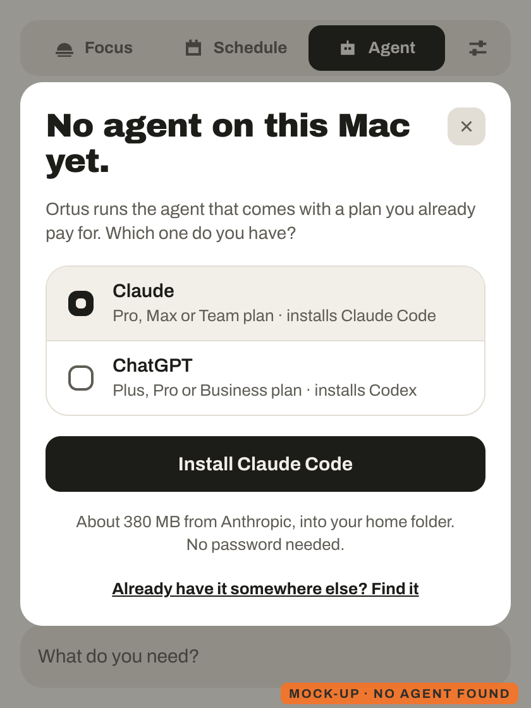 | **02 Installing**<br>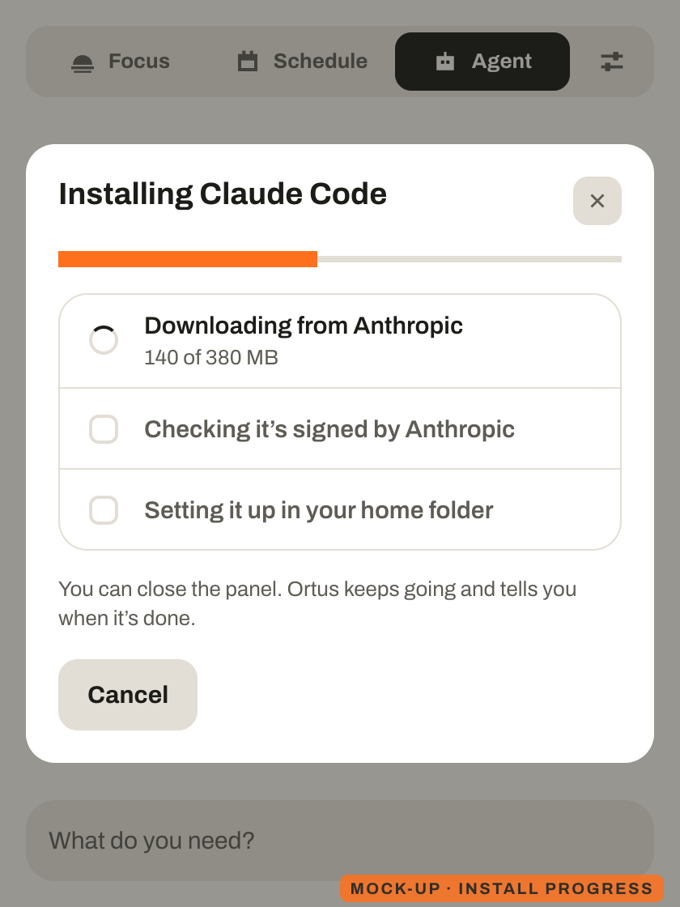 | **03 Install stopped**<br>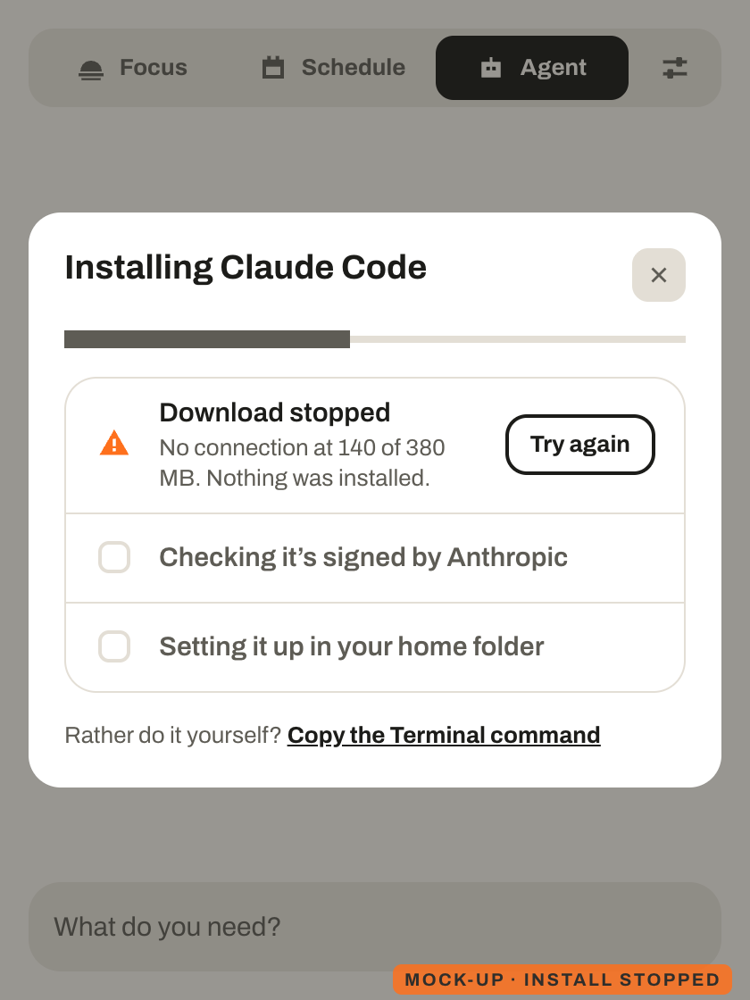 |
| **04 Sign in, Claude Code**<br>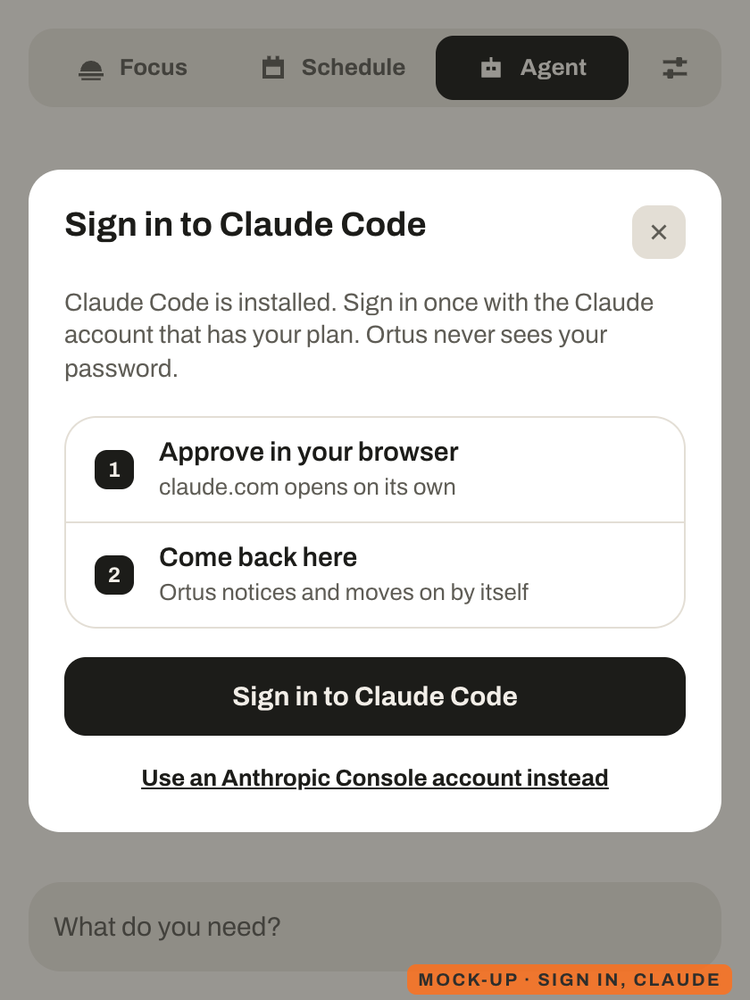 | **05 Waiting for the browser**<br>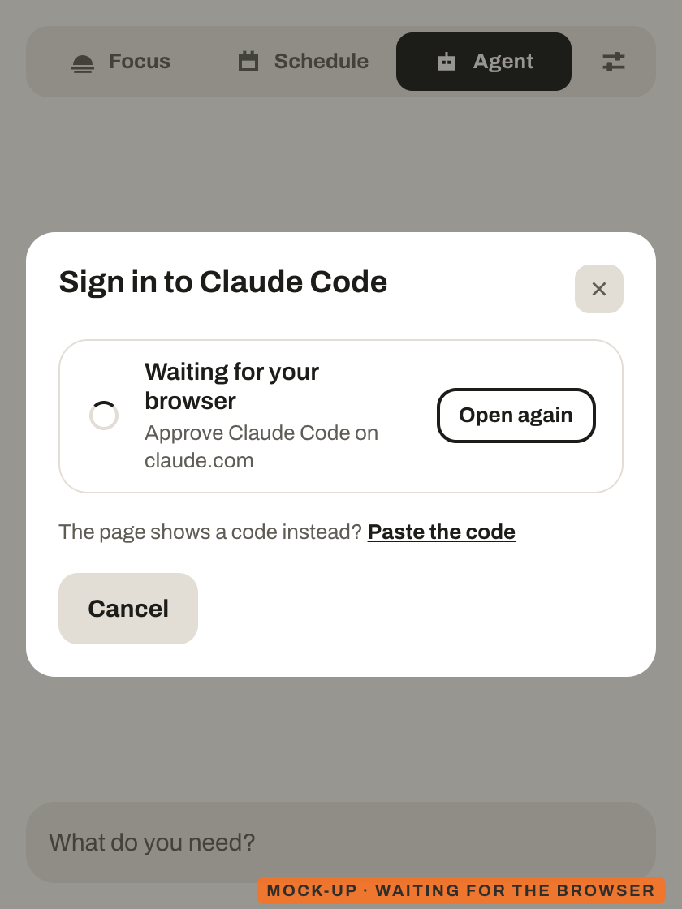 | **06 Ready, Claude Code**<br>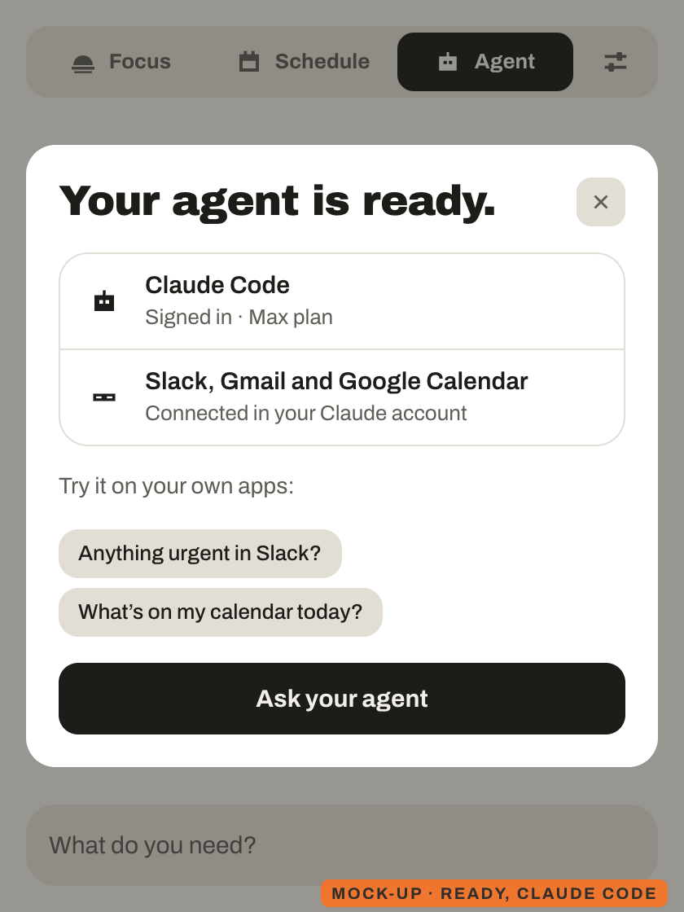 |
| **07 Sign in, Codex**<br>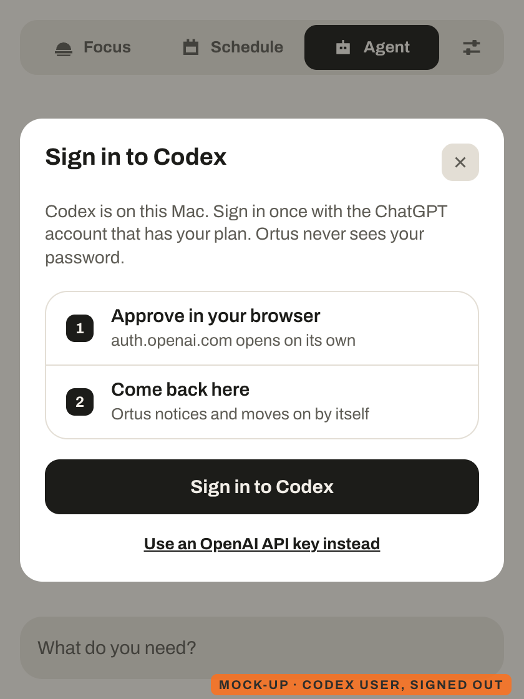 | **08 Ready, Codex**<br>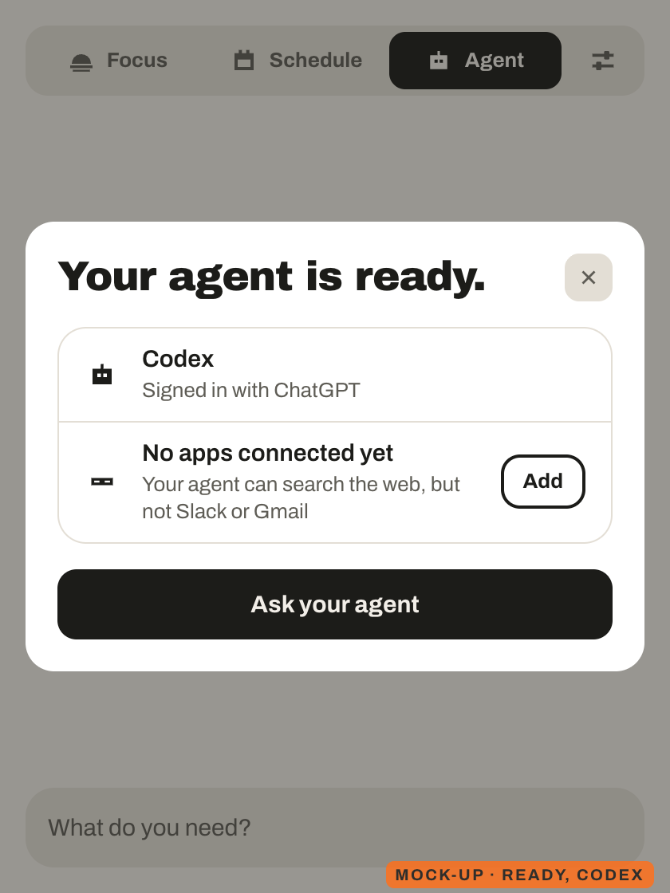 | **09 Both installed**<br>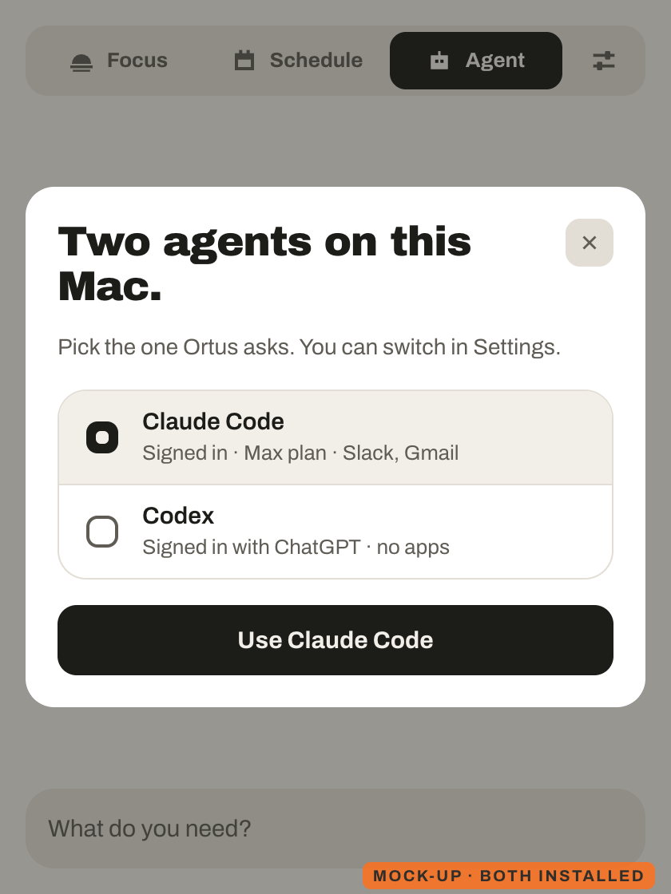 |
| **10 Only the Claude app**<br>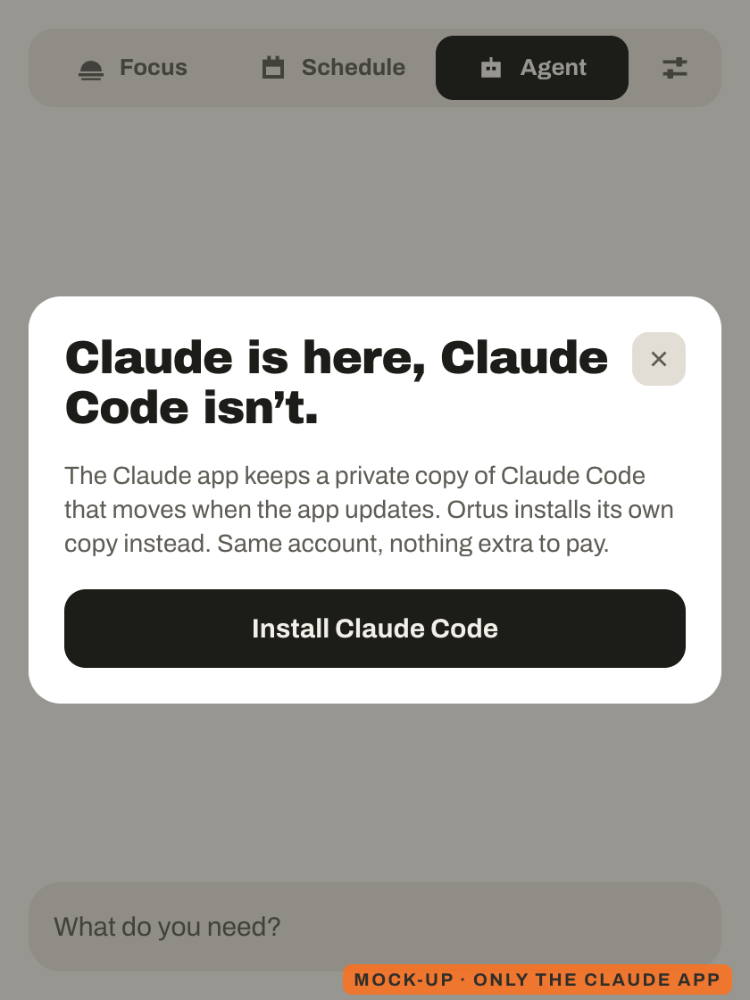 | **11 Settings: the engine**<br>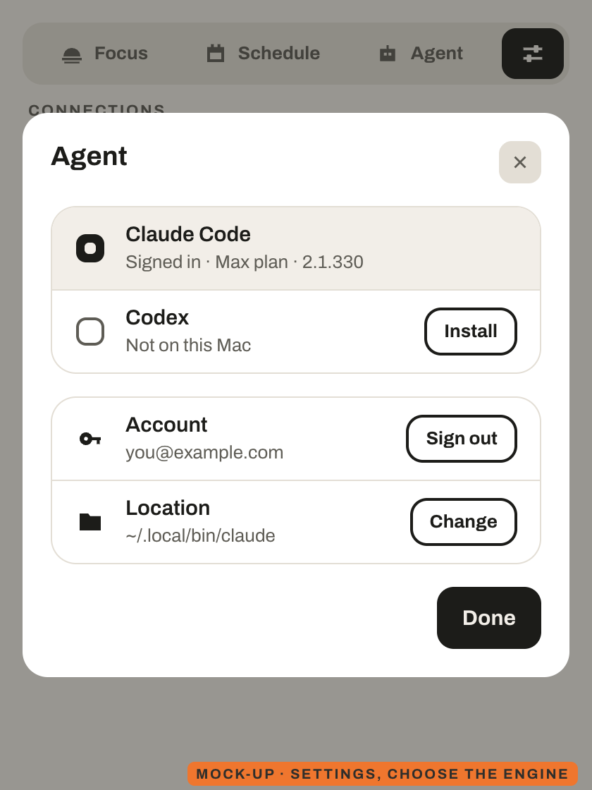 | **12 Installing during a session**<br>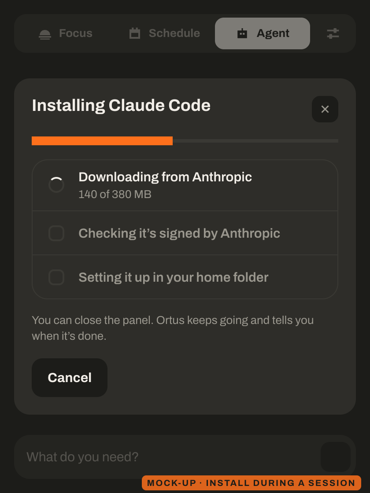 |

## Engineering spec

### Shape

Three new pieces and one renamed one. Whatever can be tested without the app goes in `OrtusCore`.

| Piece | Where | Job |
|---|---|---|
| `AgentEngine` protocol, `ClaudeCodeEngine`, `CodexEngine` | `Ortus/Services/Agent/` | Find the CLI, read its sign-in, build the command for a turn, name its sign-in and install steps. |
| `AgentEvent`, `ClaudeStreamParser`, `CodexExecParser` | `Sources/OrtusCore/` | Turn one JSON line into neutral events. `ChatTurn` applies events instead of reading raw JSON. |
| `EngineInstaller` | `Ortus/Services/Agent/` | Download, verify, install, report progress. |
| `ClaudeCodeService` → `AgentService` | `Ortus/Services/` | Same job as today (messages, process, stop, retry, clear), but asks the selected engine for the command and the parser. |

```swift
enum EngineID: String { case claudeCode, codex }

struct EngineInstall: Equatable {
    let path: String
    let source: Source        // .override, .standalone, .homebrew, .npm, .loginShell, .desktopApp
    let version: String?
}

enum SignIn: Equatable {
    case signedIn(plan: String?)   // "Max plan", "ChatGPT", "API key"
    case signedOut
    case unknown(String)           // the CLI didn't answer: show it, don't block
}

protocol AgentEngine {
    var id: EngineID { get }
    var name: String { get }                          // "Claude Code", "Codex"
    func locate() async -> EngineInstall?
    func signIn(at install: EngineInstall) async -> SignIn
    func signInCommand(_ kind: SignInKind) -> [String] // ["auth", "login"], ["auth", "login", "--console"], ["login"], ["login", "--device-auth"]
    func turn(_ request: TurnRequest) -> [String]     // argv for one message
    func makeParser() -> AgentStreamParser            // a fresh one per turn
    var install: InstallRecipe { get }
}

struct TurnRequest { let prompt: String; let systemPrompt: String; let session: Session }
enum Session { case new(id: String?), resume(id: String) } // Claude Code takes an id up front; Codex reports one
```

The shared event vocabulary:

```swift
public enum AgentEvent: Equatable, Sendable {
    case sessionStarted(id: String)
    case text(String)                         // a finished block of answer text
    case thought(seconds: Int)
    case toolStarted(id: String, name: String, input: [String: String])
    case toolFinished(id: String, failed: Bool)
    case finished(error: String?)
    case signedOut                            // the CLI said so mid-turn
}
```

`ChatTurn.consume(_ line:)` becomes `ChatTurn.apply(_ event:)`. Its rules stay: text before a tool call is narration and moves into the activity, `ToolSearch` stays hidden, the naming table stays. The Codex parser names MCP calls `mcp__<server>__<tool>`, so the same table produces "Searched Slack “haroun”".

### Codex event parser

| Codex line | `AgentEvent` |
|---|---|
| `thread.started {thread_id}` | `sessionStarted(thread_id)`; `AgentService` keeps it for `resume` |
| `item.completed` `reasoning` | `thought(seconds:)`, timed from the previous event |
| `item.started` `mcp_tool_call {server, tool, arguments}` | `toolStarted(id, "mcp__<server>__<tool>", arguments)`. For `server == "codex_apps"`, the app (Slack, Gmail…) is read from the tool name. |
| `item.started` `web_search {query}` | `toolStarted(id, "WebSearch", ["query": query])` |
| `item.started` `command_execution {command}` | `toolStarted(id, "Bash", …)` → "Ran a command" |
| `item.completed` for those | `toolFinished(id, failed: status == "failed" \|\| error != nil \|\| exit_code != 0)` |
| `item.completed` `agent_message {text}` | `text(text)` |
| `item.*` `todo_list`, `file_change`, `collab_tool_call` | ignored (or "Changed files" if `file_change` ever shows) |
| `turn.completed` | `finished(error: nil)` |
| `turn.failed {error.message}` | `finished(error: message)` |
| `error {message}` | kept as the last error; used only if the turn then fails |
| anything else | ignored, so new event types don't break old builds |

The Claude Code parser is today's `ChatTurn.consume`, moved: `system/init` → `sessionStarted`, `assistant` blocks → `text` / `thought` / `toolStarted`, `user` tool results → `toolFinished`, `result` → `finished`, and a `result` of `Not logged in…` → `signedOut`.

### Detection

Runs when the Agent tab or the setup popup opens, and on "Check again". Static paths first (instant), then the login shell (already capped at 5 s), then the desktop apps. First hit wins within an engine.

| Order | Claude Code | Codex |
|---|---|---|
| 1 | Location override (Settings) | Location override |
| 2 | `~/.local/bin/claude` (official installer) | `~/.local/bin/codex` (official installer) |
| 3 | `/opt/homebrew/bin/claude`, `/usr/local/bin/claude` | `/opt/homebrew/bin/codex`, `/usr/local/bin/codex` |
| 4 | `~/.claude/local/claude`, `/run/current-system/sw/bin/claude` | — |
| 5 | `$SHELL -ilc "command -v claude"` | `$SHELL -ilc "command -v codex"`. An npm install resolves to a Node script: run it with the login shell's PATH, or resolve its native binary in the package's `vendor` folder. |
| 6 | Claude app copy: reported, not used (decision 4) | ChatGPT app copy: reported, not used |

Then sign-in for every engine found, in parallel: `claude auth status --json` (exit 0 / 1, `subscriptionType`, `authMethod`) and `codex login status` (exit 0 / 1, text on stderr). Both are local reads and take well under a second.

Connected apps, for the Ready and choice screens, in the background: `claude mcp list` prints one line per server, e.g. `claude.ai Slack: <url> - ✔ Connected` or `! Needs authentication` (checked on this Mac; text only, and it health-checks every server, so it takes a few seconds). `codex mcp list --json` lists configured servers; which ChatGPT apps sit behind `codex_apps` is an open question. Only Slack, Gmail, Calendar, Drive and Notion are named; anything else counts as "other apps".

Which engine runs: the one saved in `agentEngine`. With nothing saved: the only one found; with both found and one signed in, that one; with both signed in, ask once (flow E).

### Install runner

One runner, two recipes.

**Claude Code: Ortus does the script's steps** (decision 2).

1. **Version and manifest.** `GET https://downloads.claude.ai/claude-code-releases/latest`, then `<v>/manifest.json`. Read the platform's `checksum` and `size`.
2. **Download.** `URLSession` download of `<v>/darwin-arm64/claude` (or `darwin-x64`) into `~/Library/Caches/<bundle id>/install/`. Progress from bytes against `size`. Cancel deletes the file.
3. **Check.** SHA-256 (CryptoKit) equals the manifest. Then `SecStaticCodeCheckValidity` with `anchor apple generic and certificate leaf[subject.OU] = "Q6L2SF6YDW"`. Anything off: delete, stop, show the problem. Nothing runs before this passes.
4. **Set up.** `chmod +x`, then run `<download> install` as the user, from the download folder, stdin `/dev/null`, a minimal environment (`HOME`, `PATH=/usr/bin:/bin:/usr/sbin:/sbin`, `LANG`), 3-minute timeout, output kept for "Show details". This is the same final command the official script runs. Delete the download.
5. **Confirm.** Detection again: `~/.local/bin/claude` exists, `claude --version` answers.

**Codex: Ortus runs the official script.** It's 1,481 lines with locking, conflict checks, pruning and an update marker that `codex update` relies on; copying it would drift.

1. Fetch `https://releases.openai.com/codex/install.sh` (the target of `chatgpt.com/codex/install.sh`) into the cache folder. HTTPS, that host only.
2. Run it with `/bin/sh`, `CODEX_NON_INTERACTIVE=1`, stdin `/dev/null`, the same minimal environment and timeout. Show its step lines ("Downloading Codex CLI", "Installing standalone package…") as the progress steps, with an indeterminate line.
3. Check the installed `~/.local/bin/codex` resolves to a binary signed by team `2DC432GLL2` before Ortus ever runs it. If not, say so and don't use it.
4. Confirm with `codex --version`.

The script adds a PATH line to `~/.zprofile`. Say so on the install screen ("also adds Codex to Terminal").

Errors for both: offline, server error, checksum or signature mismatch, disk full, the set-up step failing, timeout. Each maps to one sentence and one fix (Try again), with "Copy the Terminal command" underneath and the raw output under "Show details". Neither install asks for a password.

### Sign-in runner

- **Start.** Run the engine's sign-in command as a child process, stdin a pipe, stdout and stderr captured. Both CLIs open the browser themselves and listen on localhost (Claude Code on a random port, Codex on 1455 or 1457).
- **Watch.** Poll the status command every 2 s while the popup shows "Waiting for your browser", and finish early when the process exits 0. On success, move to Ready without a click.
- **Fallbacks.** Claude Code: "Paste the code" writes it plus a newline to the child's stdin (it reads it at "Paste code here if prompted"). Codex: "Use a code instead" runs `codex login --device-auth` and shows the code it prints.
- **Cancel or close the popup:** terminate the child. Timeout after 10 minutes.
- **API accounts.** Claude Code: `claude auth login --console` (sign-in on the Anthropic Console; Ortus never sees a key). Codex: a secure field, piped to `codex login --with-api-key`; Codex stores it; Ortus keeps no copy.
- **Signed out later.** Claude Code: the turn ends with `Not logged in · Please run /login` → `signedOut`. Codex: after any failed turn, run `codex login status`. Either way the Agent tab shows the problem above the input ("You're signed out of Claude Code." / "Sign in"), and the fix opens the sign-in screen.
- Never offer `codex login` while signed in: it signs out first.

### Running a turn

Unchanged for Claude Code. For Codex, `AgentService` builds the command from the engine, sets stdin to `/dev/null`, runs it in an Ortus-owned folder (`~/Library/Application Support/<bundle id>/agent`, so no git checks and no project `AGENTS.md`), and keeps `thread_id` for the next message. "Clear" forgets the thread id, as it does the Claude session id.

### Settings

| Key | Type | Default | Note |
|---|---|---|---|
| `agentEngine` | `claudeCode` / `codex` / empty | empty (choose automatically) | New |
| `claudeBinaryPath` | String | empty | Kept |
| `codexBinaryPath` | String | empty | New |

No migration: with `agentEngine` empty and only Claude Code found, Ortus behaves as today.

## Tests

- **Parsers (OrtusCore checks, no app needed).** Recorded JSONL fixtures for each engine: a plain answer, one MCP call, a failed tool, narration then a tool, signed out, a network error, a stopped run. Assert the `AgentEvent`s and the final `ChatTurn` (activity summary, answer, failure). Record the Codex fixtures on a throwaway account when building; the fixtures in this spec come from the source and docs.
- **Detection.** A temporary `HOME` with fake executables at each path; assert the order, and that a desktop-app copy is reported but not chosen.
- **Sign-in status.** Fake `claude`/`codex` scripts that print the recorded JSON/text and exit 0 or 1.
- **Installer, offline.** A local HTTP fixture server serving a manifest and a small signed binary (any Apple-signed tool copied in): checksum mismatch stops; wrong team ID stops; cancel deletes the file; finish-step failure surfaces the output.
- **Installer, real, in CI.** On the macOS runner (disposable), with `HOME` set to a temp folder: install Claude Code end to end, then `claude --version` and `claude auth status` (exit 1). Same for Codex. Weekly plus on changes to the installer, so a layout change upstream shows up before users hit it.
- **Snapshots.** New states for every screen in the mock-ups: `agent-setup-choose`, `-installing`, `-install-failed`, `-sign-in`, `-waiting`, `-ready`, `-both`, `-desktop-only`, `agent-settings`, and the locked install.
- **By hand, before merging each step:** a fresh macOS user account (as on 24 Nov), on Apple silicon and if possible Intel: no CLI → install → sign in → first answer; then sign out in Terminal and confirm Ortus notices.

## Rollout

| Step | Ships | Behind a flag? | Effort |
|---|---|---|---|
| 1. Sign-in in Ortus | `claude auth status` check, "Sign in to Claude Code" with waiting state and code paste, signed-out problem in the Agent tab | No: it only replaces a dead end | 1–1.5 days |
| 2. One-click install | Installer runner, progress and failure screens, plan question (with Claude only until step 3), notifications | No | 2–3 days |
| 3. Codex | Engine protocol and `AgentEvent` refactor, Codex detection, sign-in, parser, settings, both-installed choice | Experimental section at first | 3–4 days |
| Testing | CI install job, fresh-account runs, snapshot states | — | 1 day |

About 7 to 10 working days of build time, plus review rounds. Step 1 alone fixes the worst part of the 24 Nov test.

Analytics (anonymous, opt-in as today): `agent_install_started/succeeded/failed` (with the failing step, never paths or output), `agent_sign_in_started/succeeded`, `agent_engine_selected`.

## Risks

| Risk | Likelihood | Cost | What to do |
|---|---|---|---|
| Anthropic tightens third-party use of subscription sign-ins again | Medium: the rules changed several times this year | Agent breaks for Claude users | Codex as the second engine is the hedge; follow the legal page; decision 1 |
| The release bucket layout changes (`latest`, `manifest.json`) | Low to medium | Install fails | The weekly CI install job catches it; the error offers the Terminal command |
| `claude auth login` behaves differently when spawned by a GUI app than in the test | Low | Sign-in needs the paste fallback | Test on a fresh account in step 1 before merging |
| Codex `exec --json` events change between versions | Medium: the CLI ships every week, and `--json` is still also accepted as `--experimental-json` | Activity line or answers go missing | Ignore unknown events; take the answer from the last `agent_message`; fixtures per version; minimum version check |
| 380 MB download on a slow connection | Medium | A few minutes of waiting | Say the size up front; let the panel close; notify when done |
| Agent tools inherit Ortus's minimal PATH (not the shell's) | Already true today | Some MCP servers launched with `npx` may not start | Out of scope; note for later (pass the login-shell PATH) |

## Open questions

- Does `claude auth login`, spawned from the signed Ortus app, exit 0 on its own after the browser approves? (Expected yes; test in step 1.)
- What does `codex exec --json` print when signed out (an `error` event, `turn.failed`, or only stderr)? Record it on a throwaway account; until then, Ortus checks `codex login status` after any failed turn.
- Does `developer_instructions` carry over on `codex exec resume`? Passing it every time is safe either way.
- Which tool names do ChatGPT's connected apps use under `codex_apps`? Ortus's activity line names the app from the tool name, so record a Slack and a Gmail call.
- Are Codex runs heavy enough to matter? The backlog note measured 72k–190k input tokens a run in September.
- Should Ortus show the plan's usage limits anywhere? Not in this spec.

## Sources

Anthropic: [setup](https://code.claude.com/docs/en/setup) · [troubleshooting install](https://code.claude.com/docs/en/troubleshoot-install) · [authentication](https://code.claude.com/docs/en/authentication) · [CLI reference](https://code.claude.com/docs/en/cli-reference) · [headless mode](https://code.claude.com/docs/en/headless) · [errors](https://code.claude.com/docs/en/errors) · [MCP](https://code.claude.com/docs/en/mcp) · [desktop](https://code.claude.com/docs/en/desktop) · [legal and compliance](https://code.claude.com/docs/en/legal-and-compliance) · [Agent SDK overview](https://code.claude.com/docs/en/agent-sdk/overview) · [Consumer Terms](https://www.anthropic.com/legal/consumer-terms) · [support: usage changes](https://support.claude.com/en/articles/15036540) · [install.sh](https://claude.ai/install.sh) · [release manifest](https://downloads.claude.ai/claude-code-releases/latest)

OpenAI: [Codex CLI](https://learn.chatgpt.com/docs/codex/cli) · [non-interactive mode](https://learn.chatgpt.com/docs/non-interactive-mode) · [auth](https://learn.chatgpt.com/docs/auth) · [pricing](https://learn.chatgpt.com/docs/pricing) · [MCP](https://learn.chatgpt.com/docs/extend/mcp) · [app-server](https://learn.chatgpt.com/docs/app-server) · [Sign in with ChatGPT terms](https://openai.com/policies/sign-in-with-chatgpt-terms/) · [install.sh](https://chatgpt.com/codex/install.sh) · [openai/codex source](https://github.com/openai/codex) (`codex-rs/exec/src/exec_events.rs`, `codex-rs/login/src/server.rs`, `codex-rs/cli/src/login.rs`, `codex-rs/core/src/mcp_tool_call.rs`, `codex-rs/tui/src/update_action.rs`) · [Homebrew cask](https://formulae.brew.sh/api/cask/codex.json)

Local checks on the maintainer's Mac (read-only, 25 Nov 2026): `codesign`/`spctl` on both CLIs and both desktop-app copies; `claude auth status --json` signed in and, in a throwaway config folder, signed out; `claude -p` signed out; `claude auth login` with no terminal and a stand-in `open`; `claude mcp list`; the public release manifest and both install scripts (read, not run); `codex --help`, `codex exec --help`, `codex login --help`, `codex login status` on 0.171.0. No installer was run and nothing was signed in or out.
